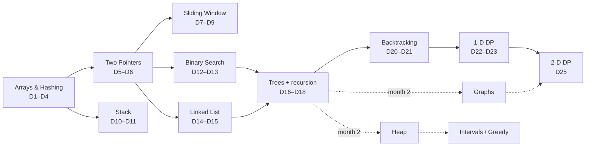

# Curriculum (21 Nov – 20 Dec 2026)

**One rule: this is the whole list.** If it isn't on today's line, it isn't today's job. You are not missing anything.

Calibrated to where you actually are (21 Nov): fewer than 50 LeetCode solved, easy Easies are trivial, no pattern solid at Medium yet; Python builds known in idea but not writable cold. Targets: Python-focused dev / data / reliability roles at Jump and Jane Street (call Mon 30 Nov).

Two phases:
- **Phase 1 – Sprint (21–30 Nov).** Get `feed-recovery` to M0–M4 (M5 stretch), one Medium + one build ladder every morning, Shizuku recording. Resume rewritten on Sun 29 Nov.
- **Phase 2 – Interview-ready (1–19 Dec).** Finish feed-recovery (M6–M10), LeetCode up to 1-D and first 2-D DP, builds until they're cold.

## What the interviews actually test

Jane Street says it avoids "algorithm bingo" and puzzles. Its problems start simple and get extended; its published example goes memoize a function → bound the cache with FIFO eviction → upgrade to O(1) LRU, and "the journey through the interview is a lot more important than the snapshot of the solution" ([prep page](https://janestreet.com/preparing-for-a-software-engineering-interview), [example interview](https://blog.janestreet.com/what-a-jane-street-dev-interview-is-like/)). Jump's format isn't published; treat it as LeetCode Mediums + systems + your project. So:

1. **Build ladders** (Jane Street style) — the most important track for you. Every build has Part 1 → 2 → 3, each a follow-up an interviewer would ask.
2. **LeetCode Mediums**, ground-up by pattern, until DP.
3. **Systems** (OS, memory, CPU, networking) — twice a week.
4. **Your project + stories** — feed-recovery is your answer to "tell me about something hard you built".

## How to learn anything in this plan (the loop)

1. **Try first, 20 minutes, no help.** Write what you can, even if it's wrong.
2. **Open the ONE source listed in the Resource map** for that item. Only that one. Stop reading as soon as the idea clicks.
3. **Close it and write the whole thing again from a blank file.** That's the version you push.
4. **Rewrite it cold 2 days later** (the 08:00 slot), and again on Sunday. If you can't, it isn't learned yet.

For LeetCode: 25-minute attempt → if stuck, watch the problem's NeetCode video only until you see the idea → close it → code it from blank → top comment: `# time: 23m, solved alone: no, idea: <one line>`.

## Where things live

| What | Where | Proof |
|---|---|---|
| LeetCode, build ladders, systems, stories | `python_study/dayN/` | `lc_<n>.py` (time + "solved alone" in a top comment), build + `test_*.py`, `systems.md` + experiment, `stories.md` |
| Showcase project | `runake25/feed-recovery` | Commits that meet the milestone's "Done when" in **`GUIDE.md`**, with pytest / hypothesis / ruff / mypy green |
| Resume | Private doc "Resume Draft" | Rewritten on Sun 29 Nov; paste it to the coach for review |
| Daily tasks and scorecards | Your 07:55 and 21:40 messages | Graded from what is pushed |
| Data business | `runake25/shizuku` | Commits + recorder running |

Unpushed work doesn't count.

## Get Cracked: three jobs, nothing else

1. **After each build ladder is green**, do the matching build/systems questions in its bank (order book, LRU/caches, queues, rate limiters). Those are its strength.
2. **Firm intel**: 30 minutes reading what people report about Jump and Jane Street rounds in its community — once before the call (Sun 29 Nov), then every Sunday.
3. **Mock days**: one of the two unseen problems comes from its bank.

Not for: browsing, new topics, or anything before the day's 3 NNs are done.

## Sundays

No folder. 1 hour: rewrite from a blank file the week's weakest build and the LeetCode problem you didn't solve alone. Then Get Cracked firm intel (30 min). Rest. Exception: Sun 29 Nov is resume day.

---

## LeetCode path (mind map)

Each pattern needs the ones before it. **DP is recursion with a cache**: you need recursion (trees) and decision trees (backtracking) first — and you'll have built the cache yourself in the memoize → LRU ladder.

Order follows the [NeetCode roadmap](https://neetcode.io/roadmap). Every problem below has a video solution on [neetcode.io/practice](https://neetcode.io/practice). Easy problems are skipped except where they're the door to a new idea (first tree recursion, first DP).

---

## Phase 1 — Sprint (21–30 Nov)

| Time | Block |
|---|---|
| 08:00 – 09:30 | **NN1**: 1 LeetCode Medium (25 min + loop) + 1 build ladder (Parts 1–3) |
| 09:45 – 13:00 | **NN2 – feed-recovery** milestone (per `GUIDE.md` §9) |
| 14:00 – 15:00 | **NN3 – Systems or story.** A story takes 30 min; the rest of the hour goes back to feed-recovery |
| 15:00 – 17:00 | **Shizuku** (tracked, not scored) |
| Evening | Off. 21:40 scorecard. |

**Target by 30 Nov:** M0–M4 done for certain; M5 stretch. That's a real story: lossy UDP fan-out with retransmit, 100 subscribers, proven consistent by hash, with numbers.

| Day | Date | NN1 LeetCode | NN1 Build ladder | NN2 feed-recovery | NN3 | Shizuku |
|---|---|---|---|---|---|---|
| 1 | Sat 21 Nov | 49 Group Anagrams | **Timer**: (1) `@timer` for any signature, returns result, `functools.wraps`; (2) still times + re-raises on exception; (3) `@timer(unit="ms")` with arguments, bad unit → `ValueError` at decoration | **M0** `book.py`: seeded generator, `set_level` choke point, incremental blake2b hash. Done when incremental hash = full recompute every step over 100k diffs | Story 1: options risk engine | `docs/PROBE_NOTES.md` for the first source |
| — | Sun 22 Nov | Rewrite timer cold · Get Cracked intel | | | | |
| 2 | Mon 23 Nov | 347 Top K Frequent | **Memo** (Jane Street's own example): (1) `memoize` a slow `int -> int` with a dict; (2) bound it to N entries, FIFO eviction in O(1); (3) explain why FIFO is wrong for hot keys and what LRU needs | **M1** `wire.py` codecs for §6, round-trip + hypothesis, clean errors on bad input, encoder rejects > 1,200 bytes | Story 2: backfill hours → < 30 s | Recorder: fetch → SHA-256 → append-only Bronze, `event_time` + `ingestion_time` |
| 3 | Tue 24 Nov | 238 Product Except Self | **Generators**: (1) `chunked(it, n)`; (2) `sliding_window(it, n)` with a `deque`, O(1) per step; (3) a lazy parse → filter → aggregate pipeline over a 1 GB file, memory flat | **M2** publisher + 1 subscriber (TCP control + UDP stream), tick loop, `config.py` invariants. Done when hashes match for 60 s | **Systems 5: TCP, UDP & multicast** | Recorder 24/7, backoff + jitter |
| 4 | Wed 25 Nov | 128 Longest Consecutive | **Context managers**: (1) class `Timer` with `__enter__/__exit__`; (2) same with `@contextmanager`; (3) `transaction()` that rolls back on exception, and what `__exit__` returning True does | **M3** checker + per-tick reports, `hist.py`, 100 subscribers over ~4 processes. Every sub consistent every tick, unplanned gaps = 0 | Story 3: escalation point, 25+ clients | Health check: alert if no new data for N min |
| 5 | Thu 26 Nov | 15 3Sum | **Data model**: (1) `Price` with `__repr__`, `__eq__`, `__hash__`; (2) ordering + arithmetic, integer ticks, no floats; (3) `@dataclass(slots=True, frozen=True)` version, and why mutable + hashable is a bug | **M4 pt 1** pure `step(state, event)` (§7), `pending`, `advance()`, scripted tests | **Systems 1: processes, threads & the GIL** | Check Bronze data is complete |
| 6 | Fri 27 Nov | 11 Container With Most Water | **LRU** (finishes Monday's ladder): (1) with `OrderedDict`; (2) dict + your own doubly linked list, O(1) get/put; (3) capacity 0/1, updating an existing key, and the follow-up "make it thread-safe" | **M4 pt 2** dropper, ring, retransmit. 1% loss, 50-burst, reorder-by-one recover with **no snapshot**; late datagram fills a hole test | Story 6: why you left, why these firms + 90-sec intro | Silver-layer plan only |
| 7 | Sat 28 Nov | 3 Longest Substring Without Repeating | **Retry**: (1) `@retry(times)`; (2) only on listed exceptions, exponential backoff + jitter; (3) injectable clock/sleep so tests run in 0 s | **M5 (stretch)** snapshot/epoch/MaxGap. Either way: README with numbers + GitHub Actions (ruff, mypy, pytest) | Story 5: JPMorgan hackathon | Still recording? |
| — | **Sun 29 Nov** | **Resume day**: rewrite the Resume Draft in one go (built / scale / measured result; feed-recovery leads with real numbers); 1-page PDF. Then Get Cracked: Jump + Jane Street intel, 30 min. | | | | |
| 8 | **Mon 30 Nov** | 424 Longest Repeating Char Replacement | Rewrite LRU cold, 20 min | Fix what the resume review flagged; send the PDF | **Call prep**: 60-sec pitch, 2-min feed-recovery walkthrough, why these firms, target roles, your questions, timeline, comp range. Mock call. **Then the call.** | — |

---

## Phase 2 — Interview-ready (1–19 Dec)

| Time | Block |
|---|---|
| 08:00 – 08:30 | Rewrite cold: the build from 2 days ago, or yesterday's LeetCode if not solved alone |
| 08:30 – 10:30 | **NN1 – LeetCode**: 2 Mediums, 25 min each + loop |
| 10:45 – 13:00 | **NN2 – feed-recovery milestone or build ladder** |
| 13:30 – 15:00 | **NN3 – Systems / story / mock** |
| 15:00 – 17:00 | Shizuku (tracked, not scored) |

If a real interview gets scheduled, the coach switches to that firm's format, then resumes here. If M5 didn't land in the sprint, it goes first on Day 9 and everything shifts a day.

| Day | Date | NN1 LeetCode | NN2 | NN3 |
|---|---|---|---|---|
| 9 | Tue 1 Dec | 567 Permutation in String, 76 Min Window Substring | **M6** `snapcache`: one upstream session, shared-future request merging, invalidate on session loss, `min_epoch` | **Systems 2: memory** |
| 10 | Wed 2 Dec | 155 Min Stack, 150 Evaluate RPN | **M6 done**: 1 upstream fetch per epoch in a restart storm; dead-epoch snapshot never served | Story 4: Hospital Authority |
| 11 | Thu 3 Dec | 739 Daily Temperatures, 853 Car Fleet | **Ladder – concurrency**: (1) producer–consumer with `queue.Queue` + threads; (2) same with `asyncio` + bounded queue; (3) add a `Semaphore` limit + per-call timeout, time both | **Systems 3: CPU & caches** |
| 12 | Fri 4 Dec | 74 Search a 2D Matrix, 875 Koko Eating Bananas | **M7 broken**: serial `await drain()` broadcast, one stuck client; measure the healthy 99 | Story 7: a mistake or failure |
| 13 | Sat 5 Dec | 153 Min in Rotated Array, 33 Search Rotated Array | **M7 fixed**: per-client writers + deadline cut; stream slow-reader control | 30-min Python internals mock |
| — | Sun 6 Dec | Rewrite cold · Get Cracked intel | | |
| 14 | Mon 7 Dec | 143 Reorder List, 19 Remove Nth From End | **M8** divergence alert: deep ghost level, alert within K reports, liveness green | Story 8: a disagreement |
| 15 | Tue 8 Dec | 146 LRU Cache (yours, cold, 20 min), 2 Add Two Numbers | **Ladder – heap**: (1) min-heap `push/pop` from scratch; (2) `heapify` in O(n) and why; (3) streaming top-k with `heapq` | **Systems 4: syscalls & files** |
| 16 | Wed 9 Dec | 543 Diameter of Binary Tree, 102 Level Order Traversal | **M9** harness: every scenario × N = 30, raw CSV, one command reproduces every number | Behavioural mock: 4 random questions |
| 17 | Thu 10 Dec | 98 Validate BST, 230 Kth Smallest in BST | **Ladder – rate limiter**: (1) token bucket with an injected clock; (2) sliding-window log; (3) thread-safe with a `Lock`, concurrency test | **Systems 6: curl a URL end to end** |
| 18 | Fri 11 Dec | 199 Right Side View, 1448 Count Good Nodes | **M10** `WRITEUP.md`: §13 outline, a plot per scenario, the three sentences | Update resume bullets with final numbers |
| 19 | Sat 12 Dec | **Mock day**: 2 unseen Mediums (one from Get Cracked), 45 min, in chat | **Project deep-dive mock**: defend feed-recovery for 30 min | Mock: Python internals + systems Q&A |
| — | Sun 13 Dec | Rewrite cold · Get Cracked intel | | |
| 20 | Mon 14 Dec | 78 Subsets, 39 Combination Sum | **Ladder – order book**: (1) add/cancel, best bid/ask; (2) matching with price-time priority; (3) O(log n) per op and why | Re-record your 3 weakest stories |
| 21 | Tue 15 Dec | 46 Permutations, 79 Word Search | **Ladder – parallel risk calc**: (1) pure Python; (2) process pool vs threads, measured; (3) NumPy vectorised, measured | **Systems 7: latency numbers** |
| 22 | Wed 16 Dec | 70 Climbing Stairs (recursion → memo → table, all three), 198 House Robber | **Speed round**, 25 min each from blank files: timer, LRU, retry | Behavioural mock 2 |
| 23 | Thu 17 Dec | 322 Coin Change, 213 House Robber II | **Debugging**: the coach gives you a buggy service; find + fix each bug, a test for each | **Systems 8: Linux debugging & signals** |
| 24 | Fri 18 Dec | **Full mock**: coding 45 min, then Python internals + systems 20 min | Behavioural 15 min (same mock) | — |
| 25 | Sat 19 Dec | 62 Unique Paths (first 2-D DP), 1143 Longest Common Subsequence | Rewrite your weakest ladder from scratch | Retro: score trend, top 3 gaps, plan for month 2 |
| — | Sun 20 Dec | Rewrite cold · Get Cracked intel | | |

Month 2 (set at the retro): heaps and graphs on LeetCode, more 1-D/2-D DP, more mocks, optional feed-recovery extensions, and whatever the scorecards say is weakest.

---

## Resource map: where to learn each thing

One source per item. Use it at step 2 of the loop, never before trying.

**LeetCode**
| Item | Learn from |
|---|---|
| Any problem in the tables | Its video on [neetcode.io/practice](https://neetcode.io/practice) (only after 25 min) |
| A pattern you've never seen (first day of a new box in the mind map) | The pattern's section of the [NeetCode roadmap](https://neetcode.io/roadmap) — watch the first problem's video *after* trying it |
| DP (before Day 22) | Alvin Zablan's [Dynamic Programming course](https://www.youtube.com/watch?v=oBt53YbR9Kk) (freeCodeCamp) — **Part 1, memoization only**, ~2.5 h, spread over Days 20–21 evenings. It's in JavaScript; write each example in Python as you go |

**Build ladders** (FP = *Fluent Python*, 2nd ed.)
| Ladder | Learn from |
|---|---|
| Timer, Retry, Memo (decorators, closures, `nonlocal`, `wraps`) | FP ch. 9 *Decorators and Closures*; [`functools.wraps`](https://docs.python.org/3/library/functools.html#functools.wraps) |
| LRU | [Jane Street's write-up of this exact ladder](https://blog.janestreet.com/what-a-jane-street-dev-interview-is-like/); the NeetCode video for LeetCode 146 for the doubly linked list |
| Generators | FP ch. 17 *Iterators, Generators, and Classic Coroutines*; the recipes at the bottom of [`itertools`](https://docs.python.org/3/library/itertools.html#itertools-recipes) (`batched`, `sliding_window`) |
| Context managers | FP ch. 18 *with, match, and else Blocks*; [`contextlib`](https://docs.python.org/3/library/contextlib.html) |
| Data model / dataclasses | FP ch. 1 *The Python Data Model*, ch. 5 *Data Class Builders* |
| Concurrency | FP ch. 19 *Concurrency Models in Python*, ch. 21 *Asynchronous Programming* |
| Heap | The theory section at the bottom of [`heapq`](https://docs.python.org/3/library/heapq.html) |
| Rate limiter | [Token bucket](https://en.wikipedia.org/wiki/Token_bucket) (Wikipedia, the algorithm section) |
| Order book | Your own feed-recovery `book.py` + GUIDE §5; then Get Cracked's order-book questions |
| Parallel risk calc / profiling | [The Python Profilers](https://docs.python.org/3/library/profile.html); FP ch. 19 for processes vs threads |

**feed-recovery** (GUIDE.md is the spec; these explain the tools)
| Milestone | Learn from |
|---|---|
| M0 hash | [`hashlib` BLAKE2](https://docs.python.org/3/library/hashlib.html#blake2), [`struct`](https://docs.python.org/3/library/struct.html) |
| M1 codecs + property tests | [`struct`](https://docs.python.org/3/library/struct.html); [Hypothesis quick start](https://hypothesis.readthedocs.io/) |
| M2–M3 UDP + TCP in asyncio | [asyncio Transports & Protocols](https://docs.python.org/3/library/asyncio-protocol.html) (`DatagramProtocol`) and [Streams](https://docs.python.org/3/library/asyncio-stream.html) |
| M4–M5 sequencing, gaps, retransmit, snapshot | The real-world version of your protocol: Nasdaq's [MoldUDP64 spec](https://m.nasdaqtrader.com/content/technicalsupport/specifications/dataproducts/moldudp64.pdf) (short — read it once before M4) |
| M6–M7 cache, backpressure | [asyncio Streams](https://docs.python.org/3/library/asyncio-stream.html) (`drain`, write buffer limits); GUIDE §8 and trap 5 |

**Systems** ([OSTEP](https://pages.cs.wisc.edu/~remzi/OSTEP/) is a free OS textbook — read only the chapters named)
| Topic | Learn from |
|---|---|
| 1 Processes, threads, GIL | OSTEP ch. 4 *The Abstraction: The Process* + ch. 26 *Concurrency: An Introduction*; the GIL entry in the [Python glossary](https://docs.python.org/3/glossary.html#term-global-interpreter-lock) |
| 2 Memory | OSTEP ch. 13 *Address Spaces*, ch. 18 *Paging: Introduction*; [`tracemalloc`](https://docs.python.org/3/library/tracemalloc.html) |
| 3 CPU & caches | [Gallery of Processor Cache Effects](http://igoro.com/archive/gallery-of-processor-cache-effects/) — reproduce examples 1–3 in NumPy |
| 4 Syscalls & files | OSTEP ch. 39 *Interlude: Files and Directories* (it uses `strace`) |
| 5 TCP, UDP & multicast | [Beej's Guide to Network Programming](https://beej.us/guide/bgnet/) ch. 1–6; then the [MoldUDP64 spec](https://m.nasdaqtrader.com/content/technicalsupport/specifications/dataproducts/moldudp64.pdf) for how exchanges recover lost packets |
| 6 curl a URL end to end | [what-happens-when](https://github.com/alex/what-happens-when) (read DNS → TCP → TLS → HTTP only) |
| 7 Latency numbers | [Latency numbers every programmer should know](https://gist.github.com/jboner/2841832) |
| 8 Linux debugging & signals | Brendan Gregg's [Linux Performance](https://www.brendangregg.com/linuxperf.html) page — the 60-second checklist |

**Stories and the call**: no outside source. Write STAR in `stories.md`, say it out loud timed, and run it past the coach.

---

## Systems track — answer these in `systems.md`, with an experiment you ran

1. **Processes vs threads & the GIL** — Demo: CPU-bound and I/O-bound work with threads vs processes, timed. Q: Why didn't threads speed up the CPU job? When do they help? What does the GIL actually protect?
2. **Memory** — Demo: `sys.getsizeof` and `tracemalloc` on a list of floats vs `array` vs NumPy. Q: Stack vs heap? Virtual memory and page faults? Why is a list of floats so big?
3. **CPU & caches** — Demo: row- vs column-wise traversal of a big NumPy array; loop vs vectorised. Q: What's a cache line? Why does locality matter? Why is NumPy fast?
4. **Syscalls & files** — Demo: `strace -c` a script; read a large file line-by-line vs in big chunks vs `mmap`. Q: What's a syscall and why is it expensive? File descriptors? The page cache?
5. **TCP, UDP & multicast** — Demo: a UDP sender/receiver and a TCP echo pair, measure round trips; show `sendto` never blocks on a stopped reader. Q: TCP vs UDP and when each? The handshake? Nagle / `TCP_NODELAY`? Why do exchanges publish market data over UDP multicast, and how is a lost packet recovered?
6. **curl a URL, end to end** — Demo: `curl -v` with phase timings. Q: DNS → TCP → TLS → HTTP. Where does the time go? What do you check if it's slow?
7. **Latency numbers** — Demo: time a dict lookup, a function call, a file read, a local socket round trip. Q: L1 vs RAM vs SSD vs network? Where do you look first in a slow service?
8. **Linux debugging & signals** — Demo: inspect the running feed-recovery publisher and a subfleet with `ps`, `top`, `ss`, `lsof`, `strace`. Q: SIGTERM vs SIGKILL? How do you debug a hung process? One at 100% CPU?

## Story bank (STAR, ≤ 2 min, real numbers)

1. Options risk engine (200K+ securities/day, 25+ funds)
2. Backfill from several hours to < 30 s
3. Escalation point under pressure (vendor outage, client impact)
4. Hospital Authority: building for non-technical users (20+ min to 5 min)
5. JPMorgan Code for Good: leading a team, 1st of 70+
6. Why you left Premialab, why this firm, why quant dev
7. A mistake or failure, and what you changed
8. A disagreement, and how it got resolved

## If you fall behind

Don't skip ahead and don't double up. If a day scores 0–1/3, repeat it. If it scores 2/3, move on and the missed item replaces tomorrow's NN3. In Phase 1, a slipped feed-recovery milestone takes the NN3 slot until it's back on track, because 30 Nov doesn't move. Resume day stays Sun 29 Nov no matter what. The coach handles this. You just open the folder.
